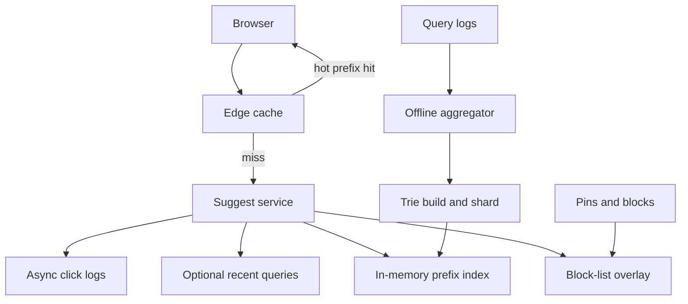

## Concept

Search autocomplete is a prefix-to-suggestions service with a latency budget so tight that most of the rest of your architecture will not fit inside it. The user types, you have a few tens of milliseconds at the edge to return 5 to 10 strings, and you must do that while the next keystroke is already on the way. This is not a general search query. Ranking a thousand-document result set is a different system. Autocomplete is an in-memory index of prefixes, a popularity model, and a cache of the hottest prefixes on earth (`"youtube"`, `"weather"`, `"how to"`).

The design I would ship is **an in-memory trie or finite-state index sharded by prefix, a daily (or faster) offline pipeline that rebuilds suggestions from query logs, and a thin online service that never touches disk on the hit path**. Personalization is a rerank of a small candidate list, not a per-user index. Safety filters run on the published list, not at type time from a database.

### Requirements

Functional: given a prefix and a locale, return top N suggestions. Optional: a small personalization signal (recent searches of this user). Click-through of a suggestion is logged. Operators can pin, block, or demote a phrase. Support Unicode and language-specific normalization (case, accents) as an explicit policy. Empty prefix may return trending, or return nothing; I would return nothing until two characters, to cut abuse and load.

Non-functional: p99 in-region of a few tens of milliseconds including network to the browser is the product. That means the service itself should sit in the low milliseconds. Availability must be high; a failed autocomplete looks like a broken search box. Staleness of the suggestion corpus of hours is usually acceptable; staleness of a block-list of minutes is not. Type-ahead QPS will exceed search-submit QPS by a large factor because every keystroke is a request.

Out of scope: spelling correction as a full search stack, answering the query, shopping cards in the dropdown, or training a transformer on the live path. Those can rerank later. Also out of scope: using this index as the only search backend.

### Capacity sketch

Assumptions: 100 million daily searchers, average 8 keystrokes per query that fire autocomplete (after debounce), 2 searches per user per day, so on the order of 1 to 2 billion autocomplete requests per day, which is tens of thousands of QPS average and well into the hundreds of thousands at peak if the product is a global search bar. Debounce on the client (wait ~30–50 ms after the last key) is mandatory; without it you multiply QPS for no quality gain.

Corpus: 10 million distinct queries worth suggesting, after cutting the long tail. A trie of those, with top-k stored at each node, can fit in tens of gigabytes depending on how much payload you hang on a node. That is a memory fleet, not a disk index. Shard by first few characters so a node holds a prefix range.

Hot prefixes: a tiny fraction of prefixes (`"f"`, `"fa"`, `"fac"`) take most QPS. Those must be cached at the edge. The tail can hit the shard.

Offline pipeline: query logs of the last 7 to 28 days, aggregated, is the training set. I would not update the trie on every search submit; that is a write path you cannot afford and a quality path you cannot moderate.

### API shape

`GET /suggest?q=&hl=&n=8` → `{ suggestions: [{ phrase, type }], q, took_ms }`

Optional header or cookie for personalization: the service reads a small recent-query list from a cache, not from OLTP.

`POST /log/impression` and `POST /log/click` should be beaconed asynchronously, not on the suggest path.

Admin: `POST /block { phrase }`, `POST /pin { prefix, phrase, position }`. Block-list is a real-time overlay.

Client contract: debounce, minimum length, cancel in-flight requests on the next key, and never block the search submit on suggest.

### Core data model

Online:

- Trie or compressed automaton: node per prefix, payload `top_k: [{ phrase, score }]`. Score is a blend of frequency, recency, and editorial.
- Shard map: prefix range → host. Often the first 1–2 Unicode characters after normalization.
- Edge cache: key `(hl, prefix)` → JSON, TTL of seconds to minutes.
- Block-list: a small in-memory set replicated to all nodes, versioned, watchable.
- Personal recent: Redis `user_id -> [phrases]` with TTL.

Offline:

- `query_log(day, query, locale, count, unique_users)`
- `suggestion_build(version, shard, blob)` published atomically. The online fleet loads a new version beside the old and flips.

Do not store every prefix of every query as a SQL row and `LIKE 'foo%'`. That will pass a demo and die in review.

## Trade-offs

| Approach | When it wins | Cost / risk |
| -------- | ------------ | ----------- |
| SQL `LIKE prefix%` | Tiny catalogs, admin UIs | Cannot meet typeahead QPS or latency |
| In-memory trie with top-k at nodes (proposed) | Tight latency, moderate corpus | Memory; rebuilds; Unicode edge cases |
| Compressed FST / automaton | Large dictionaries, prefix + fuzzy | Build complexity; harder incremental update |
| Inverted index (search engine) | Need fuzzy, tokens, and suggest-as-you-type on documents | Heavier latency; overkill for query-log phrases |
| Edge cache of hot prefixes | Power-law traffic | Stale trending; cache stampedes on expiry |
| Per-keystroke personalization from OLTP | Theoretically better | Misses the latency budget; privacy and fan-out |
| Online update of trie from live queries | Fresh memes | Poisoning, moderation lag, write load |
| Offline batch rebuild | Quality control, stable ops | Hours of lag on breaking news |

I would rebuild the corpus offline on a cadence of minutes to hours depending on how news-like the product is, overlay a small real-time trending table for a few thousand phrases if we must be fresh, and keep the trie read-only. Fuzzy correction can be a second candidate source if the prefix misses, not the first.

Debounce versus responsiveness: too much debounce and the dropdown feels drunk; too little and you pay QPS. Do it on the client, and still make the server cheap.

## Diagram

## Failure modes

### Hot prefixes

The prefix `"a"` or a celebrity name maps to one shard and one cache key. That shard's CPU becomes the product. Mitigation: store top-k at short prefixes on every node or at the edge, do not shard on a single first letter for languages with tiny alphabets without also replicating the hot heads, and cap N so you never serialize a thousand suggestions.

### Thundering herd on cache expiry

A popular prefix expires at the same moment on thousands of edge nodes, or a deploy clears the cache. All nodes rebuild from the origin trie. Mitigation: staggered TTL, stale-while-revalidate, and a singleflight at each edge node. The origin trie should still be able to serve the herd, which is why it is in memory.

### Poisoned suggestions

A coordinated group submits a slur or a scam URL as a query until frequency promotes it. Offline aggregation without unique-user thresholds will promote it. Mitigation: score by unique users not raw count, editorial block-lists with fast distribution, rate-limit the log ingest per client, and never take the raw live stream as truth.

### Unicode and normalization splits

`cafe` versus `café`, or Turkish dotted i, produce different prefixes and a user sees nothing. Or worse, two shards own visually identical prefixes. Mitigation: a documented normalizer used in both the build and the query path, plus tests. Changing the normalizer is a full rebuild.

### Rebuild and version flip

A bad build publishes empty top-k for a shard. Flip is instant regret. Mitigation: canary a shard, compare overlap with the previous version, keep previous version in memory for fast rollback, and never delete the old index until the new one has served production.

### Personalization leaking

Reranking with recent queries in a shared cache keyed only by prefix can leak one user's search into another's dropdown if the cache key omits user. Mitigation: the shared cache is never personalized; personalization is a local merge after fetch. That also keeps the hot cache hit ratio intact.

## Real-world example

Google Suggest is the product everyone is actually comparing you to. The public story over the years is a mix of log mining, aggressive caching, and a lot of policy. It is not a MySQL `LIKE`. YouTube and Amazon have their own typeaheads with catalogs (titles, SKUs) mixed with query logs. Those are closer if your product is a store, not the web.

What I would copy from Google Suggest: treat autocomplete as its own SLA and its own index; mine queries with unique-user dampening; cache the insane head of the prefix distribution; debounce; and put safety on the list, not on a hope. What I would not copy: the full personalization and knowledge-graph overlay, or the operational scale of a global edge, as a v1. A regional in-memory fleet plus CDN cache of the hottest prefixes is the honest first system.

What I would copy from an e-commerce typeahead (Amazon-style): mixing catalog entities with query phrases, and pinning sponsored or navigational suggestions explicitly so they are not "whatever the trie said." What I would not copy: hitting the product search index on every keystroke. Catalog suggest can be a second trie of titles, still in memory.

## What to remember

- Autocomplete is an in-memory prefix index with a cache for the hot head, not a search engine query per keystroke.
- Debounce on the client and top-k at trie nodes are what make the QPS survivable.
- Rebuild offline; overlay blocks and pins online; do not train the trie from raw live queries.
- Personalized rerank happens after a shared, cacheable candidate fetch, or you will leak and miss the latency budget.
