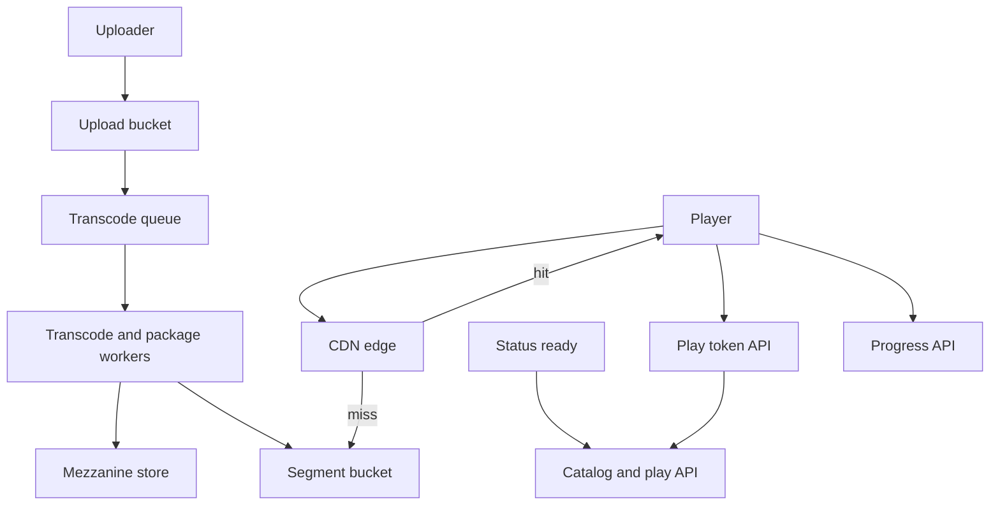

## Concept

A video streaming service is a packaging and distribution problem sitting on top of a large, mostly immutable object store. The player does not download "the movie." It downloads a manifest, then a sequence of small media segments at a bitrate the current network can support, preferably from a cache a few milliseconds away. The origin exists for the miss. If the origin exists for the hit, the bill and the buffering ratio will both be wrong.

The design I would ship is **upload → transcode into adaptive bitrate ladders → package as HLS (and DASH if we need it) → store segments in object storage → serve through a CDN with signed URLs**, plus a small control plane for metadata, play tokens, and watch progress. Live is a different pipeline (ingest, packager, low-latency variants) and I would not pretend VOD and live share a worker. They share the CDN and the player.

### Requirements

Functional: upload a video, process it, play it on web and mobile with seek, pause, and resume. Adaptive bitrate: the player can step up and down the ladder. Subtitles as sidecar files. Watch progress so resume works across devices. A catalog API: title, duration, thumbnails, allowed regions. Signed playback so a URL cannot be hotlinked forever. Optional: live events later.

Non-functional: time-to-first-frame of a few seconds on a healthy network is a reasonable product goal; sub-second is a live/ads problem. Rebuffering ratio is the SLO that matters more than origin QPS. Durability of the mezzanine (the high-quality master) is sacred; we can rebuild renditions from it. CDN hit ratio should be high for popular titles; long-tail titles will miss and must not melt the origin. DRM is a product/legal requirement in some catalogs; I treat it as an optional packager output, not as a rewrite of the architecture.

Out of scope: a full recommendation system, user-generated-content social graph, and building our own last-mile ISP caches. Also out of scope: interactive branching video.

### Capacity sketch

Assumptions: 20 million monthly actives, 4 million daily, average 40 minutes watched per daily user, average bitrate during playback around 3 Mbps as a planning mix of 720p and 1080p. That is on the order of 4 million × 40 × 60 × 3×10^6 bits per day, which is many petabits of egress. Almost all of it should leave from CDN caches, not from our origin buckets. Origin capacity is sized for miss, not for viewership.

Storage: a two-hour title at a full ladder (say 240p through 1080p, maybe 4K for a subset) plus audio and subs is tens of gigabytes per title. Ten thousand titles is already hundreds of terabytes. Mezzanine files are larger. This is object storage, lifecycle to colder tiers for unused mezzanines, and we do not put segments in a database.

Upload QPS is tiny compared to play QPS. Transcode is a queue of CPU/GPU hours. The spike is "new episode of a popular show," when the CDN is still cold in some regions.

### API shape

Control plane (authenticated):

`POST /videos` `{ title, file_hint }` → `{ video_id, upload_url }`

`POST /videos/{id}/complete-upload` kicks transcode.

`GET /catalog/{id}` metadata.

`POST /play/{id}` `{ device, drm? }` → `{ manifest_url, token, expires_at, captions[] }`. The manifest URL is CDN, signed, short-lived. The player then talks only to the CDN.

`PUT /progress/{id}` `{ position_sec }` debounced from the client.

Internal: transcode workers read from the upload bucket, write renditions and a manifest, then flip `video.status` to ready.

I would not have the player call our API per segment. That path will not survive.

### Core data model

`video(video_id, owner, title, duration_sec, status, mezzanine_key, ready_at)`.

`rendition(video_id, height, bitrate, codec, playlist_key)`.

`segment` is not a SQL row. It is an object key convention: `vid/{id}/{rendition}/{seq}.m4s` plus an `index.m3u8`.

`play_token(jti, video_id, user_id, exp, device)`. Validated at the CDN via signed cookies or at a lightweight authorize endpoint the CDN can consult. I prefer signed URLs or cookies so playback does not depend on our auth service per segment.

`progress(user_id, video_id, position_sec, updated_at)`.

`job(video_id, pipeline: transcode | thumb | package, status, worker, attempt)`.

Catalog metadata (synopsis, ratings, regions) can live in a search index later; the play path must not need it.

## Trade-offs

| Approach | When it wins | Cost / risk |
| -------- | ------------ | ----------- |
| Progressive download of one MP4 | Tiny catalogs, internal tools | No ABR; poor seek; origin or app servers hold the bytes |
| HLS/DASH ABR (proposed) | Variable networks, seek, CDN-friendly segments | Packaging complexity; player bugs; storage multiplier of the ladder |
| Single bitrate | Controlled networks (in-flight, kiosks) | Buffering on cellular; wasted bits on good Wi-Fi |
| CDN in front of origin | Any real viewership | Cache key and auth mistakes leak or miss; cost is the product |
| Origin-only | Prototypes | Egress bill and buffering; one popular title is an incident |
| Pre-package all renditions | VOD, predictable quality | Slow publish; storage cost |
| Just-in-time packaging | Sparse long tail, many versions | CPU on miss; harder caching; origin work on the play path |
| WebRTC / ultra-low-latency | Interactive live, auctions | Not VOD; expensive; different CDN story |
| DRM (Widevine/FairPlay) | Licensed catalogs | Player and packager complexity; support burden |

I would pre-package VOD into HLS with a sensible ladder, put segments on a CDN, and keep just-in-time packaging in reserve for a long tail of rarely watched originals if storage becomes the issue. I would not stream from app servers. I would not invent a custom chunk protocol when HLS exists.

Ladder design is a cost decision: each rung multiplies storage and transcode. Copying Netflix's 4K HDR ladder for a user-generated 30-second clip is how the transcode queue never drains.

## Diagram

## Failure modes

### Origin overload and cache miss storms

A new episode publishes, or a CDN provider has a regional miss storm, or a cache key includes a unique token so every user misses. Origin GET QPS follows viewership instead of miss rate. Mitigation: cache keys must ignore per-user tokens (sign with cookies or a short shared token per title), prefetch popular titles to the CDN on publish, origin rate-limits with a stale-if-error if a previous version exists, and a multi-CDN failover. Never put `user_id` in the segment URL.

### Thundering herd on a popular segment

The first segment of a popular title and the audio init segment are hotter than the rest. One object, many requests. CDNs are built for this; your origin is not. Mitigation: those objects must have long TTL, high replication at the edge, and origin shielding (a mid-tier cache) so the bucket sees one pull.

### Transcode backlog and poison files

A bad file loops a worker, or a viral upload day fills the queue, and "ready" lags. Mitigation: isolate pipelines by priority (studio catalog versus UGC), timeouts, dead letters, and a status the client can poll. Do not let UGC starve licensed catalog if that is the business.

### Storage corruption and bad packaging

A truncated segment, a mismatched duration in the manifest, or a wrong codec flag. Players buffer forever or crash. Mitigation: validate manifests in the pipeline, canary-play in a headless player before flipping ready, checksum objects, and keep the mezzanine to re-package. Treat "ready" as a publish step, not as "worker exited 0."

### Token leakage and hotlinking

A signed URL with a long expiry is posted publicly. Mitigation: short TTL, cookie-based signing bound to a path prefix, revoke via CDN where possible, and do not put the only authorization in a query string that a screenshot can copy for a week.

### ABR oscillation

The player hunts up and down the ladder on a flaky network, wasting the buffer. That is mostly player policy, but a ladder with too many close rungs makes it worse. Mitigation: fewer rungs, sensible step sizes, and measure rebuffering not just average bitrate.

## Real-world example

YouTube and Netflix are the two reference systems, and they are not the same product. YouTube is UGC plus a long tail plus ads plus live, with transcode at enormous scale and a CDN (including their own edge) that must absorb whatever is viral today. Netflix is a controlled catalog, obsessive encode efficiency, prefetch, and Open Connect boxes in ISPs so the "CDN" is often inside the network that serves the user.

What I would copy from Netflix: ABR as the default, origin shielding, encode ladders as a cost and quality project, and treating CDN hit ratio as an SLO. What I would not copy into a first service: building ISP appliances, a research encode team, or the full personalization stack as a blocker to playback.

What I would copy from YouTube: an asynchronous transcode pipeline, a player that can start on a low rung, and the honesty that UGC will upload broken files. What I would not copy: comments, subscriptions, and a global social graph as part of the streaming design, or serving playback from the application tier.

For almost every company, the copyable core is "package HLS, CDN the segments, sign access, keep a mezzanine." The rest is catalog and product.

## What to remember

- Players fetch manifests and segments from a CDN; the origin is for misses and publish.
- Adaptive bitrate packaging multiplies storage and saves rebuffering; the ladder is a budget.
- Cache keys must not include per-user identity, or a hit ratio of zero will look like an origin outage.
- Keep a mezzanine, validate before ready, and treat transcode as a queue with priorities, not a side effect of upload.
